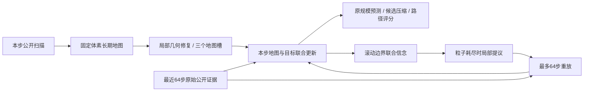

# 有界地图 v3：实现与实验

本次用户授权将地图改为“长期地图状态＋有限原始观测窗口＋边界联合信念＋局部恢复”。这是地图算法修改，身份为 `coupled_search_bounded_v3`；不能把结果声称为 v2 等价加速。原 v2、缓存实现、配置、来源与证据均保留。

## 状态和数据流



1. `persistent_map.py` 将每步公开射线压缩到固定的 `20×20×10=4000` 个体素，累积并截断 log-odds，无按年龄清空。命中/已观测标记也长期保留。地图分辨率随声明世界尺寸计算；实际 spacing 写入结果。占据体素只沿 x 方向合并，盒并集不吞掉已知空闲体素。上限 192 盒，超限明确失败。未知补全盒只可位于未观测区域；只替换被新证据否定的补全盒。
2. `bounded_belief.py` 保留最多 W 个原始步证据、W 个联合状态快照和一个边界状态。边界状态包含地图槽、目标位置/速度、地图概率 alpha 和条件粒子概率 omega。旧证据滑出原始窗口时，它已形成的后验由边界携带。普通更新不重新处理完整历史。
3. 几何变化时对现有粒子做几何有效性筛选并更新联合质量；条件有效样本数低于 N/2 时做系统重采样。正常重采样仅复制正权重样本，不加抖动，不给排除的证据补权重。
4. 目标或几何筛选导致联合质量归零时，从边界正质量粒子进行有限抖动提议，位置标准差 .35、速度 .08，速度仍受原先验最大值约束。用当前地图重放窗口内证据，单次最多 W 步，最多两次尝试，共享原 3 秒推断预算。不能恢复就明确失败，不全历史重建、不在完整方案中全局均匀重置。

体素占据支持、地图变化后的粒子迁移、边界抖动提议都是有限近似。边界不是任意地图变化下的精确充分统计量；已滑出的连续射线也无法逐条重新验证。独立解析检查证明特定旧负观测的零质量可传过窗口边界，不能据此声称所有历史约束在新几何下严格等价成立。

## 为什么默认 64 步

W=64 为原预测时域 H=16 的四倍，在 dt=.2 的设置下对应 12.8 秒近期原始证据。提供 W=32/128 对照，需用耗时和任务结果选择，64 只是有明确规模的起点。W=16 只用于不超过32步的物理机制检查，结果明确标识为短窗口夹具。

完整方案长期网格三个主数组共40000字节；3×32粒子的边界数组5400字节，64个快照数组345600字节。原始事件、Python对象、快照引用的有界几何、去重和审计容器仍有额外内存，不能把数组字节当成进程总内存。去重最多2(W+1)+8个事件ID，审计最多1024条。消融 window_map 另外保留 W 个预处理体素证据帧，成本单独记录。

M=3、N=32、H=16、执行场景3、原始路径12、代表4、路径查询72、候选区域24、推断3秒与规划20秒均未缩小。4智能体、28D/3D/124D、gamma=.95、奖励、网络、优化器、训练时序、动力学、目标/障碍过程、发现/交接/终止不变。

## 三层检查

```powershell
python -m tools.check_bounded_map --output work/bounded_endurance_01 --execute
python -m tools.run_checks --output work/bounded_regression_01 --execute
```

第一条只用640批合成公共格式证据（每批26方向×4载体），不创建模拟环境或模型。扫描探针和负观测轨迹独立指定，直接输入滤波器，并非一个真实物理回合的回放。自然运行和第192/384/576步人为耗尽粒子的故障运行分开统计。保存 `endurance.json`、`steps.csv`、`report.md`；v2或消融失败、历史上限等均保留，不能把截断后的耗时当作完成640步。它验证长期状态界限和恢复机制，不估计真实恢复频率，不代表闭环任务性能。

第二条跑完整静态和回归检查，不运行物理回合。`--map-workflow` 才会执行共享上限8回合×32步、每个临时模型最多4次完整多智能体更新的接入检查；不恢复检查点文件。不要为计时重复执行短回合流程。

## Linux 手动实验

矩阵文件 `configs/bounded_design_experiment_v1.json` 包含七项：

| 项目 | 用途 |
|---|---|
| reference_v2 | 原完整历史缓存 v2 对照，历史上限512，回合400步 |
| full_w64 | 完整方案，默认窗口64 |
| full_w32 / full_w128 | 窗口代价和任务表现折中 |
| no_boundary_w64 | 仅恢复时把边界提议改为均匀先验；须有恢复才能解释差异 |
| no_local_recovery_w64 | 粒子耗尽即失败，测恢复的必要性 |
| window_map_w64 | 只重组窗口内预处理地图证据，测长期地图记忆作用 |

每项单独训练与原生评估 NEW_ZERO、NEW_B2、NEW_B3。ZERO不训练。各项共享物理训练场景、顺序、评估场景和创新种子；不同地图的B2/B3独立从头训练，不复用跨地图权重。各项条件哈希和输出目录不同。

pilot：1个训练种子、30回合、每回合最多400步、每10回合保存检查点、6个固定验证任务、12个开发评估任务。7项共14个学习模型、420个训练回合；建议先运行 full_w64 和 reference_v2，再按需要启动窗口及消融。formal：2个训练种子、300回合、12个验证任务、100个最终评估任务，与开发阶段生成种子分离。最终集不可用来挑窗口或参数。

在用户明确提交/上传后的干净 Linux 检出中执行：

```bash
python -m tools.validate_checkout --output work/bounded_linux_01 --require-linux --execute
python -m cli bounded-experiment prepare --root work/collision_terminal/bounded_pilot_01 --stage pilot --execute
python -m cli bounded-experiment run --root work/collision_terminal/bounded_pilot_01 --arms full_w64 reference_v2 --validation work/bounded_linux_01/validation.json --execute
for arm in full_w32 full_w128 no_boundary_w64 no_local_recovery_w64 window_map_w64; do
  if ! python -m cli bounded-experiment run --root work/collision_terminal/bounded_pilot_01 --arms "$arm" --validation work/bounded_linux_01/validation.json --execute; then
    echo "Incomplete arm retained: $arm"
  fi
done
python -m cli bounded-experiment report --root work/collision_terminal/bounded_pilot_01 --output work/bounded_pilot_report_01 --execute
```

正式阶段改为新的 root 和 `--stage formal`。不带 `--execute` 的入口只展示参数，不读检查点、不训练、不创建输出。此轮仅本地工程验证，没有自动启动上述长期训练。

## 如何分析

- `arms.csv` 和 `summary.json` 先确认哪些项目完成；失败项不从总实验消失。失败的首回合可能没有完成的 episodes 行，v3另写 `map_failure_*.json` 保存信念与步耗时。文件位于运行配置的 output_dir；评估出错时该路径可能指向该模型训练目录。
- 各项原生报告包含 Found、Success、碰撞、发现时间惩罚、折扣回报、运行耗时，以及训练/固定验证曲线。`paired_deltas.csv` 为 full_w64 减各对照，种子与场景交叉自助区间，ZERO只有场景不确定性。未完成的对照不给出完整性能差异结论。
- `resources.csv` 逐任务记录窗口/盒上限、快照数组、观测体素、恢复和重放工作、几何迁移及回合前/中/后三分之一推断p50/p95。逐步 trace 和条件ESS保留在原始episode指标内。对时间增长，应同时看等长未发现任务及逐步CSV，避免把早发现或早失败当成提速。
- 完整流中 raw history 必须≤W，单次恢复≤W、两次总工作≤2W，盒≤192，网格恒4000。检查自然运行中的恢复率、失败率与晚期p95；人为故障数据只验证机制。
- 只有计算量变稳且任务效果无明显恶化，才能支持这个设计。工程检查通过不等于Linux长程超时消失，也不等于论文性能验收。

## 来源

v3用 `provenance/map_bounded_manifest.json`、`map_bounded_evolution.json` 和 `verification/map_bounded_v3/<源码身份>/` 绑定新证据；cache父版清单、原证据及其冻结归档均不可变。独立验证器核对v2几何/滤波/目标传播字节、所有其他受保护环境/学习器文件以及逐项修改理由。不提交、不推送、不重标旧权重。

## 本地长流结果

640批公开观测流中，所有完整方案均完成640批。以下为自然运行前/后三分之一的推断p95，包含本机调度差异，不能作为Linux端到端加速比：

| 项目 | 完成批数 | 原始历史峰值 | 前期p95秒 | 后期p95秒 |
|---|---:|---:|---:|---:|
| v2参考 | 183，下一批预算失败 | 184 | .33065 | 2.38537 |
| full_w32 | 640 | 32 | .01843 | .01994 |
| full_w64 | 640 | 64 | .01690 | .02385 |
| full_w128 | 640 | 128 | .02074 | .01840 |

完整方案最大19盒、4000网格单元，其中1305个单元积累过观测；window_map结束时只保留786个已观测单元。三次人为耗尽中，完整方案32/64/128分别最多重放32/64/128步并恢复成功；关闭局部恢复在第192步故障处明确失败。这些结果支持“原始历史和恢复工作不再无限增长”的机制判断，尚不足以选择最优窗口或判断任务性能。

计时原始身份为 `e1fba79a...`；随后只把新增实验单元测试夹具的验证数量从非法1修正为最低合法2，并更新演化哈希，得到当前 `5407dca7...`。最终证据保留原始计时身份和源码清单，逐文件核对运行时代码、配置、计时工具及其解析检查依赖字节均相同，不重新标记原始结果。当前源码的192项回归另行全量通过。

当前源码另通过8个短物理回合，共240步；4个临时模型各4次完整更新，直接用内存模型评估且权重保持不变。v3训练夹具32步后，原始历史16、边界步16、快照16，覆盖了多次边界滑动。夹具本身未自然触发局部恢复，恢复有效性来自解析检查与长流故障注入。没有正式训练或检查点文件恢复。

最终证据位于 `verification/map_bounded_v3/5407dca7221053fc1a399ab84b09a73ad6ec7a47c8792356ea1801a48613f202/`，包含长流逐步CSV、原始身份复核、完整回归日志、原生短回合输入/指标和七项准入报告。
