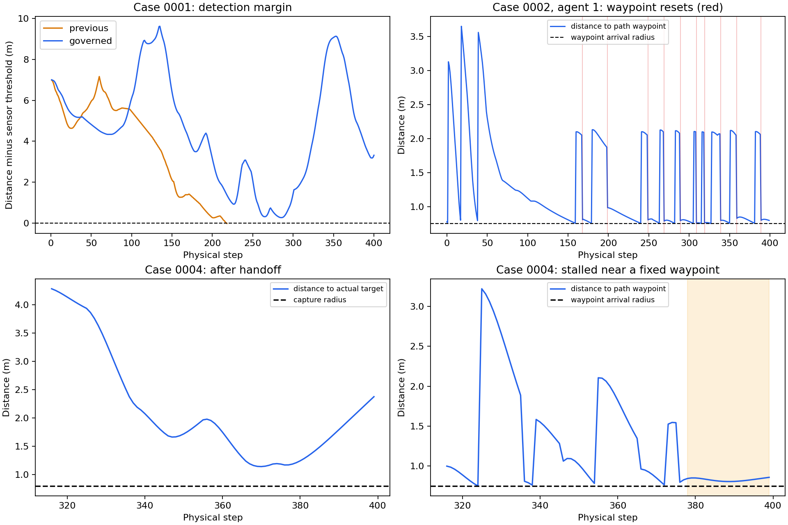

# Linux governed 六场景原始轨迹核查

本轮上传目录：`3090结果/r123_governed_20261116_215327_3078331`。这是对上一份仅有 report.json 的分析补充；此次取得 plan、validation、governed、report 及日志，已能独立核对完成状态和逐步轨迹。本审计只读取结果和代码，未修改生产代码、上传文件或历史结果，未运行环境、训练或恢复权重。

## 完成与结果可信度

- governed/completed.json 存在，六个场景完整，实际评估共 2053 个物理步。
- 源码身份为 b604b90bc7586e4e5198587f17b77c7a4d57ab2b406a31f52b724237c37247f6，与当前 governed manifest 一致。
- Linux validation：96 项检查通过；2 个环境、64 步原生验证通过；训练更新为 0。
- 独立校验 validation 全部附件哈希、plan 输入哈希、config/options 身份，以及新旧 completed.json 中 episodes、metrics、summary 哈希，全部一致。
- 从新旧 episodes.jsonl 重新计算全部非耗时指标，与上传 report 一致；每场轨迹均为结束步数 ×4 条；各场均标记 task_network_trained=false。目录内 report 与顶层 report 完全一致。
- training_allowed=false、performance_accepted=false 是规则比较工具的固定限制，不表示未完成；也不能据运行完成就视为性能验收通过。

| 任务指标 | 上次 no_recovery | 本次 governed |
|---|---:|---:|
| 成功 | 2/6 | 2/6 |
| 发现 | 2/6 | 3/6 |
| 碰撞 | 0 | 0 |
| 搜索器静止步数 | 2042 | 6 |
| 搜索器低速且远离端点步数 | 2317 | 440 |
| 搜索器刹车动作步数 | 2911 | 35 |
| 主动恢复进入次数 | 0 | 0 |

原先“普通候选动作不可用、只能刹车”的运动死锁已明显缓解。完整任务成功率没有提高，不能将动作层修正等同于整体任务问题解决。这轮是规则控制评估，没有进行强化学习训练。

## 1. 0002：确认了路径查询后进度反复倒退

本场剩余 344 个低速远端点步中，agent 1 占 255 步；其中 248 步执行动作 0，只有 4 步执行刹车。它已不是原来的“动作被全部屏蔽”现象。

agent 1 在第 100—399 步间，水平安全速度上限中位数约 0.100 m/s，反复跟踪 `[3,3,2.5]` 与 `[5,5,2.5]`。轨迹证实：旧路线推进到 `[5,5,2.5]` 后，下一次路径查询又返回 `[3,3,2.5]`，共发生 **10 次**；每次返回都伴随 route_id 改变。例如第 159→160 步向下一节点推进，第 167→168 步重新查询后退回前一节点。完整窗口发生 25 条路线身份变化。

代码对应：

- `chapter3_bser/r123_repair/runtime.py:146`：root_only 且停滞时按查询间隔生成新 Route，随后仅按当前位置和 0.75m 半径推进。
- `chapter3_bser/path_option/path_context.py:42`：Route.advance 只按当前节点距离推进，没有跨查询保存已完成的路径进度。
- 查询可能再次包含当前栅格中心；智能体刚跨过旧到达边界，却因重新查询时离该中心略超 0.75m，被要求返回。

低安全限速、靠近中间点的减速控制，以及重查后丢失已完成节点共同造成低速往返。这里不能直接放宽安全阈值或增设恢复模块。应优先检查新旧路径衔接：保留已经完成的进度，并且只有经过现有几何检查、确实允许向前衔接时才跳过旧节点。本次只确认问题与修正方向，没有声称某种衔接实现已经验证有效。

## 2. 0004：交接正常，但固定路点与移动目标速度前馈不匹配

第 315 步发现，第 316 步收到目标，交接只用 1 步，剩余约 17 秒。交接距离约 4.279m。整个捕获阶段执行器没有执行刹车动作，也没有 navigation_blocked；不能再归因于原来的强制刹车死锁。

实际最近距离为 **1.142161m**，发生在第 369→370 步，未进入 0.8m 捕获范围；接触 0 步、连续保持 0 步。轨迹记录中的 capture_swept_min_distance 是最后一步的值，不是全局最小值，本审计按全部捕获阶段逐步重新计算。

第 378—399 步，执行器连续跟踪固定中间节点 `[13,9,2.5]`，到该节点距离始终约 **0.807—0.859m**，超过 0.75m 到达半径。与此同时目标继续移动，任务端点更新至约 `[15.326,9.500,4.244]`，但实际跟踪点仍停留在旧中间节点。

代码对应：`chapter3_bser/r123_governed/control.py:14` 仅按 phase==2 决定叠加 packet.target_velocity，不区分当前 track 是固定中间节点，还是移动捕获目标。该行为继承了原有 phase 2 控制思路；本轮限速修正保留了它。它会在固定路点控制上引入非零稳态偏差，使路点距离可能收敛在到达半径之外。

用本场末段目标速度和最后一步 cap，在零流、固定节点、无裁剪饱和的简化稳态方程中，`position-track = [2.4*vx/cap_xy, 2.4*vy/cap_xy, 1.2*vz/cap_z]`，其模约 **0.952m**，已大于 0.75m。这是控制公式的解析反例，用来说明机制可能性；不是实际几何下的修复后回放，也不证明单独修正前馈就一定能捕获。

应将“固定路径节点的导航”与“移动目标附近的捕获跟踪”在控制输入语义上对齐：固定节点不应直接携带目标速度；接近移动目标时再使用相应速度。频繁生成新 Route 导致重新追起始栅格中心的问题也需要一并核查。不能仅用“发现晚了”解释这条轨迹，也不能据这六场断言剩余 17 秒必然足够。

## 3. 0001：搜索轨迹改变后错过目标，不是未训练网络的问题

旧版第 218 步由 agent 2 发现，最近距离约 2.8246m，阈值 2.85m，只进入约 **2.54cm**。这是一次比较贴近探测边界的相遇。

新版在同一第 218 步，三个搜索器距真实目标分别约 3.467、6.683、5.466m；整场按各自探测阈值比较的最佳接近是第 285 步 agent 1 距目标约 2.7121m，其阈值 2.45m，仍差 **0.2621m**。

因此，运动方式改变确实改变了与移动目标相遇的时机和空间覆盖。现有证据没有发现探测阈值被改动、已满足条件却漏触发的错误。离线重建目标轨迹后，重新计算扫掠探测判据，新旧六场的首次探测步全部吻合原始 found_step。这一结果不能简单归因于地图实现错误或奖励错误，也不能保证移动更顺就能在每个场景发现更早。

0000 同样未发现，最佳探测余量仍差约 0.553m；0002 虽较旧版更接近目标，最佳余量仍差约 0.406m。后续应看覆盖、重复访问及时间分配，而不是只看移动距离。

## 其他结果与判断

0003 第 186 步发现、210 步完成；0005 第 217 步发现、243 步完成。两场交接延迟均为 1 步，捕获都有 6 步接触和 5 步最大连续保持，完整流程能执行成功，成功规则未被绕过。

平均折扣回报 0.14927→0.12624；平均未折扣回报 1.74812→2.01867。两个口径方向不同，gamma=.95 使较晚事件折扣很强，不能只凭一个总回报指标判定控制修正是否有效，更不能据此直接改奖励。原始文件没有逐步奖励分量，尚不能精确归因折扣回报下降。

建议保留已奏效的限速一致动作构造，主动恢复继续关闭。下一步优先处理两处具体接口问题：路径重查后的进度连续性，以及固定中间节点上的移动速度前馈。建议用四组比较隔离作用：当前 governed、仅修路径衔接、仅修前馈语义、两者都修；保持同一六场景、种子、奖励、动力学、捕获判据和步数预算。这是下一步实验建议，本次没有启动或修改实验。检查完成前不宜直接开启整套长训练。

本轮六个开发场景不构成跨种子或正式泛化性能验收；新控制在本轮没有碰撞，也不等同于已经建立安全证明。

## 可复现性与保留

`analyze.py` 重新计算哈希、指标、探测和捕获距离，生成 `analysis.json` 与下图。目标运动只使用公开场景初始条件、现有纯函数做离线审计，不建立环境，不把真值写回控制器。

CH3/CH4/CH5 分别 369/103/318 个非缓存、非 Git 文件的审计前后哈希一致；上传目录和保留的旧 no_recovery 目录也逐文件一致。见 `before.json` 和 `immutability.json`。本轮创建文件仅在本审计目录，见 `created_files.json`。
