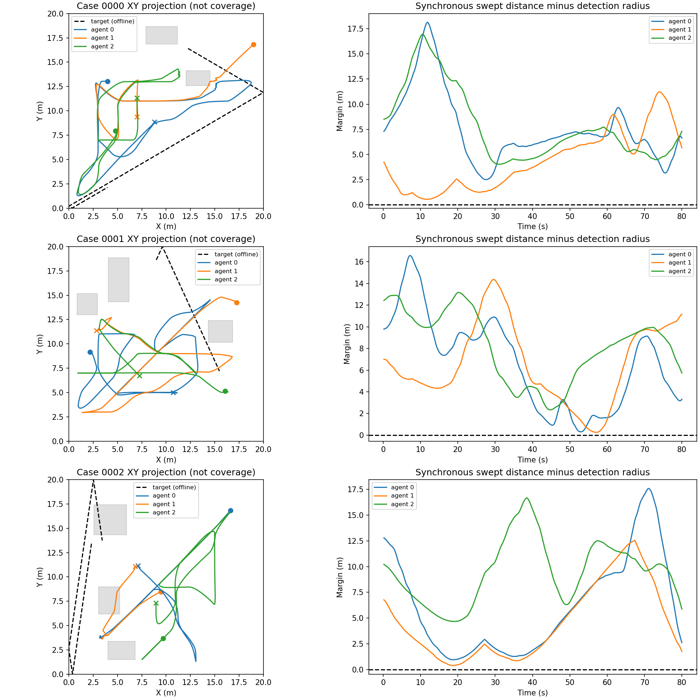

# 未发现目标场景的只读原因检查

日期：2026-11-17。对象：tracking 的 both 组，重点 0000、0001、0002；同时完整分解六场剩余319个低速搜索器步。本次没有修改运行代码、配置、奖励或任务判据，没有创建环境、执行物理步、训练、恢复权重或连接Linux。

结论：三场均没有发生满足原探测条件的同步相遇。0000、0001有明显的时空错过，0002同时存在搜索轨迹空间缺口和严重的局部执行耗时。还确认了分配层端点与执行层根任务长期不同的接口事实，但其对失败的净贡献未被消融证实。现有日志不足以把原因唯一归为地图错误、候选池错误或400步太短；不应马上增加模块或启动训练。

## 数据身份与计算口径

- 新结果：`3090结果/r123_tracking_20261117_121047_2475513/both/episodes.jsonl`及其plan；保留旧governed原始数据和上一份tracking审计作为输入核验对象。
- 当前tracking源码身份见输入清单：`1b51edf677adca45266d8e5ecf818f060f08d8a7ec0b2d476710ce8d127f6326`。本次没有重新标记任何旧结果。
- 目标仅在离线审计中，用原`core/env/target_motion.py`纯函数、场景初始位置/速度、反射障碍、dt=.2重建；初始位置沿用既有审计的float32转换。没有将目标真值或未来轨迹输入控制器。
- 用原`swept_relative_min_distance`核对每个物理步的同步相对扫掠距离。搜索器0/1/2传感半径为2.0/2.35/2.75米，加原`detect_eps_bias=.1`，有效判定半径为2.1/2.45/2.85米。六场重建首次发现步均与原记录一致。
- 表内时间为连续相遇时刻；`step`是原trace的零起点索引，物理完成步为`step+1`。低速定义为步前速度<.05且到当前endpoint距离>.8，限定搜索器phase=0。
- 空间访问代理仅用步前位置落入2×2×1米体素；连续驻留不重复记为进入，离开后返回才算重复进入。这不是传感覆盖率、自由空间覆盖率或地图重建。
- 离线“异时空间最近距离”比较搜索位置采样与目标0—400步位置采样，允许二者时刻不同。它用于说明曾到过相近空间，不代表存在可实现的改速方案；采样点不接近也不证明连续扫掠并集完全无交集。

## 每个失败场景的证据链

### 0000：没有同步相遇，存在空间接近但时刻错开；局部受限与分配重复并存

| 搜索器 | 同步最近距离m | 有效半径m | 最近时刻s | 距阈值余量m | 实际行程m | 低速步 |
|---|---:|---:|---:|---:|---:|---:|
| 0 | 4.610898 | 2.10 | 27.441 | 2.510898 | 73.82 | 1 |
| 1 | 3.003295 | 2.45 | 11.620 | .553295 | 40.75 | 10 |
| 2 | 6.882573 | 2.85 | 30.998 | 4.032573 | 55.12 | 30 |

确认：全程未进入阈值，不能指控探测器漏报。agent0在step166的采样位置距目标step67位置仅.257米；agent2的step55与目标step331相距.428米，但都不是同时相遇。说明单看XY交叉或最终访问过某区域不足以解释移动目标发现。

初始agent0、2同指向[1,1,1.5]；400步内，D2当前分配的三个端点至少两个完全相同有162步，执行根任务端点重复有218步。后者与前者统计的是不同层，不能相加。搜索器合计14次`TASK_COMPLETE`释放，任务流转仍发生，没有整场陷入WAIT_TASK。

agent1在step78以`NO_ACTIVE_RECOVERY`释放根任务，CONNECTOR合计50步，step128接受新任务；agent2的step200—202、204—229贡献29个非初始化低速步，跟踪点涉及[13,15,3.5]与[11,15,3.5]，水平cap约.12—.175m/s，导航候选仍可用。该处确有局部执行成本，但不能证明去掉29步就能相遇。

主要解释：已确认的直接失败机制是80秒内搜索与目标运动未同步进入探测范围。重复端点、分配/承诺不同步、局部低速均为可定位的候选贡献因素；缺少逐次候选得分、信念与公开地图，不能给出它们各自造成的漏发现概率。

### 0001：仍在有效搜索，几何相遇只差约.262米；低速不是共同主因

| 搜索器 | 同步最近距离m | 有效半径m | 最近时刻s | 距阈值余量m | 实际行程m | 低速步 |
|---|---:|---:|---:|---:|---:|---:|
| 0 | 2.408562 | 2.10 | 52.842 | .308562 | 82.85 | 1 |
| 1 | 2.712147 | 2.45 | 56.969 | .262147 | 55.94 | 3 |
| 2 | 5.186340 | 2.85 | 44.648 | 2.336340 | 55.57 | 9 |

确认：三人共约194米行程、19次任务完成释放，仍未满足原半径。agent0的step266与目标step219采样相距.552米；agent1的step70与目标step214相距1.553米，都在其有效半径内但时间不同。时空错过得到直接支持。

初始agent0、1同指向[1,3,3.5]；当前分配重复113步，根任务重复133步。总低速只有13步，其中4步来自step0或初始化后尚未加速的step1，不能把本场失败主要描述成“长期停着不搜索”。agent2的step308—309、316—321为8个后段低速步；agent1的step149为孤立低速步。

主要解释：有限时域内选路/到达时序没有形成有效相遇，尚无单一执行死锁证据。本场尤其适合检查分配模型与实际执行时间的偏差；不能因为距阈值近就扩大探测半径，也不能声称延长少量步数必定发现。

### 0002：左侧低深度带未被有效接近，两个搜索器长期耗在同一局部区域

| 搜索器 | 同步最近距离m | 有效半径m | 最近时刻s | 距阈值余量m | 实际行程m | 低速步 |
|---|---:|---:|---:|---:|---:|---:|
| 0 | 3.058816 | 2.10 | 18.683 | .958816 | 49.07 | 80 |
| 1 | 2.855595 | 2.45 | 18.650 | .405595 | 18.43 | 134 |
| 2 | 7.525221 | 2.85 | 18.913 | 4.675221 | 63.99 | 9 |

确认：目标轨迹范围x=[.00494,3.43637]、y=[.02744,19.99047]、z=[1.42952,1.59107]。三名搜索器各自采样轨迹与整条目标采样轨迹的异时最近距离仍为2.41458、2.59232、7.13993米，分别超过其有效半径。这比0000/0001更明显地暴露了实际搜索路径的空间接近不足；它仍是采样轨迹诊断，不是真实覆盖率证明。

初始三人全部指向[1,1,1.5]。当前分配端点重复138步，根任务重复108步。agent0、1在障碍左上侧约[3.3—3.8,3.6—4.0,2.5]附近耗时；agent2在step65释放初始根任务后转向[17,17,2.5]并最终到达，后来主要在右侧运动。全场8次任务完成均来自agent0/2；agent1没有根任务完成。

agent1的根任务事件链：step98释放初始任务；108接受[15,15,2.5]；138释放并接受[15,9,5.5]；168释放并接受[15,15,4.5]；198再次释放；199恢复同一身份并进入TRACK_ROOT；249/259/269/279有已确认的路径进度接续；300因UNASSIGNED释放并进入connector；315接受[7,13,.5]。最终位置约[6.881,11.315,1.471]，仍未完成该根任务。

路径修正帮助离开卡点的既有结论保持成立，不能把这段移动称为原任务完成或新增发现。本次进一步确认：agent1 step199—246有48个连续低速步，cap约.086—.098m/s；agent0 step122—177有56个连续低速步。

离线真实AABB距离：agent0上述长段约.637—.676米，agent1 step199—246约.623—.637米。它们接近真实障碍边角；原安全padding=.4+.12=.52米，另有刹车/扰动模型及未知区域缩放。原记录的available_distance有约.04—.06米的小值。这支持“真实障碍邻近且公共安全治理极慢”，但available_distance并非直接真实净空，不能用真值距离替代公开安全判断，也不能据此降低padding。

主要解释：左侧目标带接近不足，与两个搜索器在同一局部通道消耗大量时间同时存在。路径重查回退已有独立证据；剩余低速的公开几何来源分解、初始同向任务的得分理由、换任务的净收益仍待核查。没有证据证明左侧目标带物理不可达，或400步内任何策略都无法发现。

## 剩余319个低速步的完整定位

| 场景 | agent0 | agent1 | agent2 | 合计 |
|---|---:|---:|---:|---:|
| 0000 | 1 | 10 | 30 | 41 |
| 0001 | 1 | 3 | 9 | 13 |
| 0002 | 80 | 134 | 9 | 223 |
| 0003 | 17 | 3 | 1 | 21 |
| 0004 | 12 | 2 | 1 | 15 |
| 0005 | 2 | 3 | 1 | 6 |
| 合计 | 113 | 156 | 50 | 319 |

0002占69.9%，三个未发现场景合计277步；其余42步发生于已发现的场景，不能全部归为失败原因。18步是六场三个搜索器的step0初始静止。

全部319步navigation_blocked=false；部署mask允许所选动作。动作计数：305步action0、3步action1、8步刹车action8、3步已验证退出action9。状态为CONTINUE 255、TRACK_ROOT 49、WAIT_TASK 8、CONNECTOR 7。289步cap_xy<.3m/s，且319步到跟踪点均>.75米。说明主要不是根端点已到达的正常停留，也不是governed以前“普通导航全拒绝后只剩刹车”的同一个问题。

0002的全部连续低速区间（闭区间，包含step0）：

- agent0：0；99—105；122—177；189—200；217—219；234。
- agent1：0；78—85；104—165；169；175—183；199—246；292；314—317。
- agent2：0；66—73。

其他场景的完整区间、每段端点/跟踪点、route_id与cap范围见analysis.json；所有319行逐步位置、根任务、endpoint、跟踪点、route_id/index、限速、available_distance、候选拒绝原因计数与部署mask见slow_steps.csv。连续区间可能跨任务/route，区间内涉及的各route_id均保留，不能把整段当成单一路径。

## 分配、根任务、几何接口的检查

**已确认的接口事实：** 当前D2分配`original`与执行根任务`task`在0000各agent分别不同143/234/128步，0001为85/308/149步，0002为130/291/170步。`r123_repair/runtime.py:85`的_options只在初次/阶段变化或task.released时接纳分配；活跃根任务不会随D2改派立即替换。这是明确的代码行为，不是凭轨迹推测。

这可能是有意保留任务承诺；但D2若按新分配计算冻结候选/联合检测增益，执行器却沿旧根任务运动，两层就不能共同代表实际执行计划。当前证据确认“两套端点长期并存”，尚不能确认这些改派逐次由何事件触发、旧根任务当时是否仍有效、立即接纳是否更好。应将其列为接口一致性风险，而非直接把所有不一致步都算作程序错误或立即取消任务。

根任务与临时endpoint不同在三个失败场景分别50、17、40步，均对应CONNECTOR步数；不等于主动恢复启用。全六场没有RECOVERY_ENTER。TASK_COMPLETE释放核对：三个失败场景共41次，释放时从前一物理步末位置到其根端点均<=.75米，没有发现仅因路径跟踪点到达而虚报根任务完成的反例。日志未保存当时pose_free与clearance，无法独立复核完整几何到达条件；此部分仍REVIEW_REQUIRED。tasks.csv的分段按TASK_ACCEPT划分，含释放后的等待/connector，不能把段末当作根任务完成时刻。

空间重复代理：0000各agent唯一访问体素/进入次数为39/47、26/28、35/38；0001为54/56、31/35、34/36；0002为20/28、12/17、34/37。0002 agent1行程仅18.43米、12个访问体素，局部重复更突出；这些数值不含探测球、不消除障碍体积、也未计算跨agent真实覆盖。相同端点也不必然意味着整条路线重合。

**起点与候选池汇总证据：**

| 计数 | 0000 | 0001 | 0002 |
|---|---:|---:|---:|
| start_preflight:invalid_start | 46 | 19 | 42 |
| short_circuited_candidate_pools | 46 | 19 | 42 |
| safety_route_failure:invalid_start | 32 | 15 | 25 |
| safety_route_failure:no_start_connector | 118 | 43 | 94 |
| recovery_failure:ATOMIC_REJECT_MISSING_SEARCH_ROUTE | 11 | 1 | 29 |
| search_candidate_unreachable_queries | 0 | 0 | 0 |

这些是planner层计数，不是互斥的物理步数，不可相加；继承的recovery_failure是D2安全重规划统计，不是主动恢复端点RECOVERY_ENTER。尤其unreachable_queries=0不能解读为所有候选都成功：SearchPoolMixin先按start_status排除不ready的智能体，再调用候选生成，整个池被短路时根本没有逐候选查询。CONNECTOR记录只告诉重试时的起点状态/是否找到，未保存当时完整图和拒绝列表。

## 代码模块与证据等级

| 模块 | 源码事实/作用 | 对本轮失败归因的等级 |
|---|---|---|
| core/env/uav_env.py:1277；target_motion.py:321 | 原同步扫掠发现条件 | 已确认三场未满足；未发现漏触发 |
| r123_repair/runtime.py:85、107、143、167、196 | 活跃根任务承诺、释放/恢复、TRACK_ROOT重查、D2重分配 | 已确认分配与执行端点长期不同；收益/伤害未定 |
| path_option/path_context.py:49；r123_tracking/progress.py:5 | 半径到达推进、同任务路径进度接续 | 已有0002局部收益；本次不再复跑证明 |
| r123_repair/planning.py:7；safety/planning_refresh.py:7 | 公开起点connector与起点状态 | 已有失败/connector计数；逐步图状态缺失 |
| safety/allocators.py:13；d2/allocator.py:86附近 | 起点池短路、原子局部分配 | 确认零不可达查询可掩盖未查询；具体拒绝候选未知 |
| candidate_generator.py:48、66 | 按信念/前沿排序，逐agent选至k候选；距离分离只在该agent已选集合中检查 | 同端点分配已确认；是否候选截断或并列排序偏置所致待查 |
| d2/solver.py:5；objective.py:69 | 按联合边际检测增益选不同agent，无跨agent端点硬排重 | 同端点本身不是违反当前求解契约，不能直接加硬排重当修bug |
| detection_model.py:15 | 对整条候选路径的空间高斯检测核，结合当前belief/q_free；没有沿路线到达时刻的目标演化积分 | 模型与移动目标/慢速执行有时序偏差的合理推测；未完成独立消融 |
| safe_rl/control.py:31；safe_rl/dynamics.py:14；reach_avoid/scan_geometry.py:104 | 距离/未知区域限速，低cap进一步降低位置误差控制；公开扫描细化几何 | 低cap与低速同现已确认；具体hit/voxel/unknown贡献未知 |

不要把检测模型说成只看终点：它实际沿路径积分空间接近的代理；局限在缺少路径执行时序，而不是完全没有路径输入。

## 最小处理方案与可区分贡献的验证

当前保留tracking两修、主动恢复关闭。本轮只提交审计材料，不直接改控制器。优先解决“能看到什么、谁承诺哪个任务”的证据缺口，再决定修复或撤回。

1. **先做行为不变的诊断增补。** 在任务接纳/分配安装时记录旧/新token、任务身份、接纳/拒绝原因与公开有效性；在route查询时记录路径点/失败、start_status、connector候选及拒绝原因；在候选池生成时记录候选/选中/冻结对象与得分分量；在主要低速窗口记录hit距离、coarse距离、unknown比例、pose_free、地图/图哈希及必要公开快照。不得调用额外随机采样，不得读取真值来决定动作。目标真值留在离线评估侧。
2. **若确认D2在评分/冻结的是未执行的新端点，最小候选修复为承诺确认接口。** 让分配层将执行层实际接受的根任务视为当前承诺；新分配仅在显式接受后成为已安装计划。保留原释放/到达/有效性检查，不因endpoint变化自动宣告旧任务成功。另一种“立即接受所有改派”会改变承诺策略，应单独实验而非顺手修复。接口修正无任务收益或增加死锁/等待时撤回。
3. **几何若证实存在过期connector/缓存或同任务跟踪进度错误，只修该接口。** 不放松阈值、不用真实AABB替代公开几何、不改占据判定来放行。若证实限制来自新鲜且正确的公开几何，应归为规划路线执行成本，不能强行抹去安全层。当前没有足够证据推出一个可安全部署的几何代码补丁。
4. **候选/检测时序属于后续规划策略研究。** 先在公开冻结状态上核对不同路线的候选得分和实际承诺；如确认初始候选截断导致同向集中，可单独比较原候选生成与一种预先固定的空间分散候选生成，保持k、求解器、奖励、目标过程、400步预算一致。不要同时增加k、硬排重和时序模型；无收益则撤回。没有取得当时快照前，这个机制归因仍REVIEW_REQUIRED。

建议有限验证顺序（均未在本次启动）：

- 诊断补丁先用纯函数/合成对象检查输出、随机数状态不变；自动环境检查如必要，累计不超过8次初始化×32步，无训练。前32步覆盖不了0002的100—279步窗口，短检查通过不能冒充该问题验收。
- 现有结果没有保存完整逐步公开地图与候选池。若补充这些数据确实必需，由用户在Linux手动执行新目录下0000—0002各1回合的**诊断复现**，规则both、不训练、不加载权重，最多1200物理步。其用途是补齐快照并核对物理轨迹与旧结果一致，不是再次证明tracking收益；先完成行为不变诊断，再讨论行为修复。当前没有新增诊断CLI，不提供虚构的可运行命令。
- 在证据确认一个接口补丁后，先单开A=当前both、B=该补丁，固定同三场配对初态/运行seed、400步。若A诊断复现已物理一致，可复用A，仅新增B三场，最多1200物理步。记录发现、最近余量、完成根任务、低速、碰撞、安全干预、查询次数与耗时；“更快移动但未发现”只算局部收益。
- 若后来另有独立候选策略变更，用A、B、C=仅策略变更、D=接口+策略的2×2，按贡献条件逐步增加；不自动启动。每组规则3场最多1200步，已合格配对组可复用。对旧成功0003—0005的必要回归最多另3×400步；开发回归不能作为泛化验收。正式独立场景/训练计划另行设计，不拿这些开发场反复调参后声称独立测试。

不需要重跑：旧A/B/C pilot、legacy/repaired/no_recovery六场、governed对照、刚完成的tracking三组与导入baseline。也不需要R123原12模型矩阵、历史权重恢复或长训练。当前没有证明延长400步预算的必要性；预算仍固定，不通过加时掩盖漏搜。

## 保留核验与交付

可复算：`python -B verification/r123_search_failure_audit/20261117_v1/analyze.py`（从项目根目录运行；仅离线计算，会更新本审计生成文件）。原始输入哈希/源码/受保护目录哈希见before.json，结果见immutability.json，完整新增文件见created_files.json。

CH3/CH4/CH5全部369/103/318个文件（含目录下所有实际文件）前后SHA256逐文件一致；本次核验未排除缓存或Git文件，当前实际计数即上述数量。414个core/chapter3_bser/tools/provenance非缓存文件及70个原始输入/既有审计文件保持字节不变。没有覆盖此前无关修改，没有提交或推送。

机器结果analysis.json保存逐场/逐agent相遇、根任务台账、低速区间及原事件；slow_steps.csv保存319条低速原始索引与诊断；tasks.csv按任务接受事件分段。failure_paths.png展示XY投影和同步距离余量，XY相交不能替代三维同步探测。

