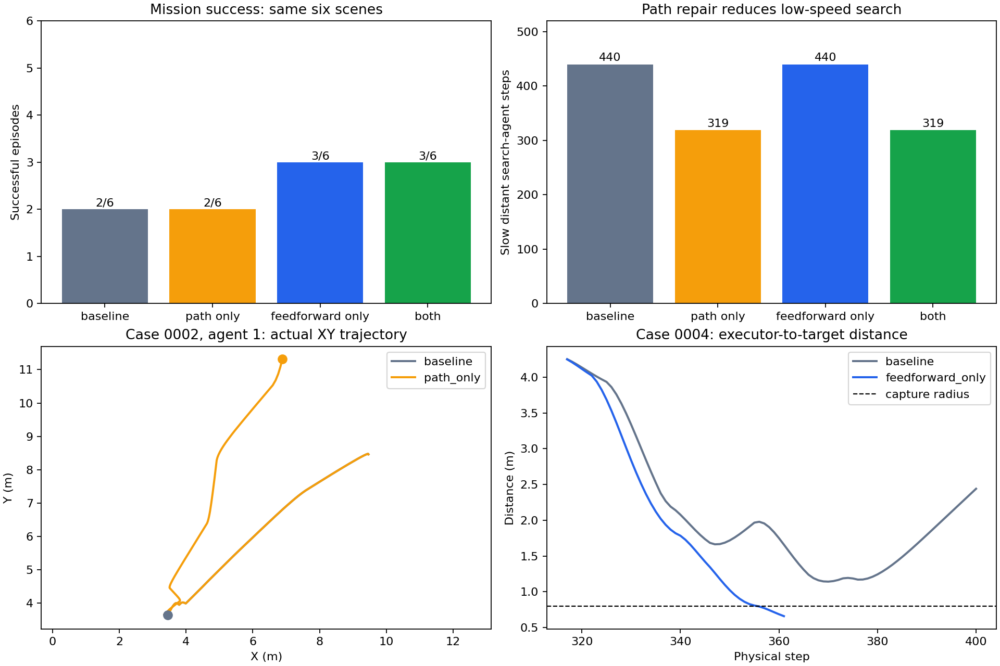

# 三组tracking消融与governed基线核查

结论：本次三组全部完成，前馈语义修正确实救回一个“已发现但未捕获”的失败场景；路径衔接修正确实减少回头与低速，但本轮未提高发现数或成功数。两者均有可定位的机制效果，整体任务仍只有3/6成功，尚不能宣称任务流程在一般场景中可靠。

## 完成状态与配对核验

输入目录：`3090结果/r123_tracking_20261117_121047_2475513`，旧基线来自同级`r123_governed_20261116_215327_3078331/governed`。顶层旧`3090结果/report.json`仍是上轮报告，本次读取的是新目录中的`report/report.json`。

- 三个新组各6回合，completed.json均存在，最终日志为ALL THREE ARMS COMPLETED、exit_code=0，报告complete_jobs=expected_new_jobs=3。
- 本轮新增完整评估6107物理步，加准备验证128步，共6235步；旧基线没有重跑，没有启动强化学习训练。
- 源码身份1b51edf677adca45266d8e5ecf818f060f08d8a7ec0b2d476710ce8d127f6326与当前tracking清单一致。Linux验证112项通过、4环境128步、原生训练更新0。
- 验证附件、计划输入、三组及基线的episodes/metrics/summary哈希、配置/选项/场景/seed、三组开关均匹配。新组18场与导入基线6场合计24条原始episode独立重算指标；报告逐场差值、均值与交互项吻合。
- 逐步重建目标轨迹并检查扫掠探测距离、捕获接触与连续保持，首次发现步、接触次数和最大保持次数与原始记录吻合；没有修改发现或成功条件。

## 四组对照

| 指标 | baseline | 仅路径 | 仅前馈 | 两项都修 |
|---|---:|---:|---:|---:|
| 成功 | 2/6 | 2/6 | 3/6 | 3/6 |
| 发现 | 3/6 | 3/6 | 3/6 | 3/6 |
| 碰撞 | 0 | 0 | 0 | 0 |
| 超时 | 4/6 | 4/6 | 3/6 | 3/6 |
| 搜索器低速远端点步数 | 440 | 319 | 440 | 319 |
| 搜索器静止步数 | 6 | 7 | 6 | 7 |
| 搜索器刹车步数 | 35 | 38 | 35 | 38 |
| 路径进度成功接续次数 | 0 | 4 | 0 | 4 |
| 捕获接触步数 | 12 | 12 | 18 | 18 |
| 主动恢复进入 | 0 | 0 | 0 | 0 |
| 完整评估物理步数 | 2053（导入） | 2053 | 2027 | 2027 |

四组发现前搜索器分母均为5754步；低速远端点比例7.65%→5.54%，总数降低27.5%，不是评估长度缩短造成的。低速定义仍为速度<0.05m/s且距任务端点>0.8m，静止为单步位移<1e-6m；不能混为同一指标。路径修正的静止增加1步、刹车增加3步，不能表述为所有运动指标均改善。

## 前馈修正：成功率改善来自0004

| 场景 | 发现步（四组相同） | baseline/仅路径 | 仅前馈/两项都修 |
|---|---:|---|---|
| 0000 | 未发现 | 400步超时 | 400步超时 |
| 0001 | 未发现 | 400步超时 | 400步超时 |
| 0002 | 未发现 | 400步超时 | 400步超时 |
| 0003 | 186 | 第210步成功 | 第225步成功 |
| 0004 | 315 | 400步超时，未捕获 | 第361步成功 |
| 0005 | 217 | 第243步成功 | 第241步成功 |

0004四组都在315步发现、316步收到目标。修正前执行器最近距离1.142161m，接触0、保持0；开启前馈修正后进入0.8m范围，第361步成功，最近扫掠距离约0.659776m、6步接触、5步最大连续保持。仍使用同一捕获任务身份，没有主动恢复进入，捕获阶段没有刹车动作。此前固定路点上的速度前馈偏差确实是此场失败的一个可修复因素。

在这六场中，baseline→feedforward_only、path_only→both的发现前搜索器位置、速度、实际控制、任务端点、路线及分配标记逐条完全相同。0004的发现时机没有提前，成功也不是路径修正带来的：baseline与path_only在本场所有智能体的物理轨迹相同；feedforward_only与both也完全相同。因此本场新增成功可明确归因于前馈开关对应的执行行为。

前馈并不是每个成功场景都更快：0003发现后完成耗时24→39步，慢15步（3秒）；0005为26→24步，快2步（0.4秒）。没有丢失原成功场景，但应保留这项效率代价记录，不能宣称全面提速。

## 路径修正：0002离开卡点，但尚无任务成功收益

baseline与path_only、feedforward_only与both两对比较中，只有0002的物理轨迹改变，其余五场逐条相同。四次进度接续全部发生于0002的agent 1，第249、259、269、279步，跟踪节点接续到[5,5,2.5]。

同上轮分析窗口第100—399步，[5,5,2.5]→[3,3,2.5]的回头切换从10次降至2次；按整回合计为11→3。此搜索器低速远端点步数255→134，降低47.45%；本场全体搜索器344→223。末段原版仍在约[3.46,3.65,2.50]附近，修正版已经离开卡点，向[7,13,1.5]等公共路线节点继续搜索。

它仍在第400步超时且未发现目标。接续只在249步后首次真正生效，不能把“恢复移动”说成“完成原任务或发现目标”。这里没有假造任务完成，也没有通过延长回合预算换取结果。当前证据支持保留这一进度一致性修正，理由是已观测的局部执行改善；不支持把成功率提升归功于它。

## 两修正的组合与剩余瓶颈

选定的逐场指标中，`both-path_only-feedforward_only+baseline`交互项均为0。本轮没有观察到额外的协同成功收益；路径收益与前馈收益分别体现在不同场景/阶段。六个场景不足以证明两修正在其他环境中永远无交互。

开启前馈后，本轮三个已发现目标都完成捕获，即条件完成率2/3→3/3；其余0000、0001、0002失败全部发生在发现前。它只说明这三条已发现轨迹的捕获流程通过，不能泛化为捕获模块已对所有目标和障碍情形可靠。

建议保留前馈修正，并保留具有局部进度收益的路径衔接修正，主动恢复继续关闭。下一步检查发现前的搜索覆盖、目标相遇时机、任务重分配和仍剩319步的低速段。不能直接断言是地图程序错误，也不能归因于“网络没有学好”：这一轮没有训练网络。当前不需要继续增加捕获、注意力或恢复模块来解释剩余失败。

平均未折扣团队回报2.01867→2.20773（两项都修）；平均折扣回报0.12623626→0.12623430，变化很小且方向不同。gamma=.95对315步之后的事件权重很低，而0003完成延迟会影响折扣指标；总回报不应取代阶段成功和接触/保持证据。本次未改奖励，也不以这份报告自动授予训练准入。

## 证据与限制

成功从33.3%升至50%只多一个开发场景，尚不构成跨种子、独立测试集或统计稳健性验收。没有重跑基线的速度基准，因此本报告不作计算提速结论；四组本轮无碰撞也不构成安全证明。

可复算脚本analyze.py，数值与逐场证据analysis.json。此次只新增本审计目录，没有改生产代码、历史结果、训练设置或源码清单，没有创建环境、更新模型或恢复权重。CH3/CH4/CH5的369/103/318个非缓存文件、453个源码文件及输入均在前后字节核验一致；见before.json、immutability.json。新增文件见created_files.json。
